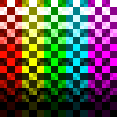

# Cub3D  

~ Started on: 13/10/2024 ~ *** ~ Ended on: 16/01/2025 Ranked with 105
-- I will re-do it! (In a minute now.. and for myself :>)

[Demo](https://vimeo.com/1047554738?turnstile=0.vb-gx-KdGT1J4DDmPiQyzy1o0bzLUDbTRW4xxfN3h3-weSP9XYvJ1id4cIcERaCqNM24wVgnjazRQ5Jz3ENmGYF02QnLZ_5ozEvG4fIQ4i2WwUQr9fGom9JiN6FE3fnc39Q8j7L5YBCwVBV9GZb0cIRmY1jbIUwgvCr7ivAUZuEyQ4FJwfPP7tYUZnMRGIJycEKpsDsJDE1sm1Fx2JQxurd6Zc2s5aEUj3jaXUgwkYd4ZMzxWFr2il4h-6ifZ-YNSrRCerptFOB4-XZ_QN9_U8Mb2WgNBaAlyoQktw0ZuTawCetRP0ElOmewaZi8_Y0pJiRjKT0wY2XP8WUoAbLBWkDCpD8DYwB0t2YLr4jNkClEHylr3G27zFD8EQLNnmEz79sFaRNoifTyL6cL02x7NDJdMOXlqzzgU86T1sXRJ3S2v07fJTdBMdd8ypOaC9lm-CYtm0LtaU4nPna9yz6fxEOQZod2MiV63M1J2uQbv8ZYXwvdZLLdlyF7iPRENknPEJSx-LXx72BBhLPclHwfpaPrQyUw95GDvez0f3EGo-fqSKhz5ksA8U4Mq2N5U4Gt-1z65DKAc5hxq18GHGJ6UnRDkxYow8Usqk_JnzZy6V54L_CFHXYYROVrMxxik37qy0B1vuLMM9eIDRWDlv8ayU0mJmh0aEFHfY79YSeRKfKkl5lBcgn1xl30OEyXkjwXxX-mWtonED_IxJKDi-Hm-qEmMG2uQcdwRKNLf-tMmPYuxqxrqh1KOps2zoMJwH9MWvNPL_bP9ggdeortE_ewnRh2b0Gbk3ENmlhvVnjsmZLkg7J0Z5H5PzvBS1FfOLTCd2MRcFXCaMhp_FHmc4ualF5gCQsoPKWYjJslSyIsBcU.CbH2XCi-Gto6Km-JgQaqRw.97ba529c7eb40a510b1994aa4b74b1e991f10ac890009ef55279e049572df675)

***
## Summary:
My first RayCaster with miniLibX ----------------------->  

This project is inspired by the world-famous Wolfenstein 3D game, which was the first FPS ever.  
It will enable you to explore ray-casting.  
Your goal will be to make a dynamic view inside a maze, in which you’ll have to find your way.

***
## Content of this repository:
- [The New_Libft](https://github.com/Sulig/New_Libft)
- [MinilibX Codam](https://github.com/codam-coding-college/MLX42)
  - // Cloned into repo when you "make"
- The Cub3D `src` and some bonus!
- [Subject English](https://github.com/Sulig/Cub3D/blob/master/Cub3D_subject-en.pdf)
**

## CONTROLS
Move on the map with: `W A S D`
 - W -> UP
 - S -> DOWN
 - A -> LEFT
 - D -> RIGHT

 - UP-KEYBOARD -> UP
 - DOWN-KEYBOARD -> DOWN

Move the vision of player with the arrows
 - LEFT-KEYBOARD -> Rotate Left
 - RIGHT-KEYBOARD -> Rotate Right

You can change the window size by just dragging the screen or clicking on the icon to make the screen large.

Close the game with `esc` or close directly with the cross icon.

### BONUS ADDED
If you execute this command: `make run-bonus` you can play at this game with these bonus:

  - Move the camera with the mouse!
  - Take a look at where you are in a fabulous minimap!
  - (Yet added in mandatory) Don't walk across the walls!
  - ¡GHOST MODE! -> `SPACE`

***

***
~      	Made by sadoming        	~
~  With the collaboration of Andmart2  ~
***
